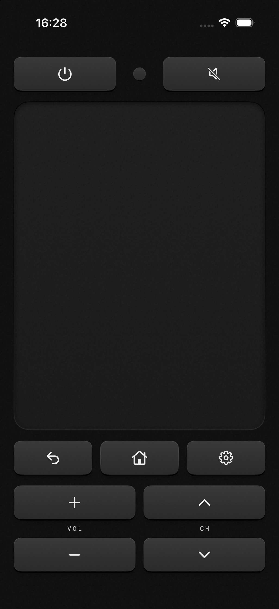

# Rimokon

A minimal iPhone remote for LG webOS TVs. iOS 17+, no external dependencies.



## Setup

1. Connect your iPhone and TV to the same network.
2. Turn the TV on, tap **Find TV** in settings, and select it. Manual IP entry is also available.
3. Allow local-network access and accept pairing on the TV. Rimokon retrieves the MAC address automatically.

Rimokon remembers the TV’s identity and searches for its new address when reconnecting fails. Discovery uses direct local connections, with no multicast entitlement. It scans IPv4 Wi-Fi networks up to 1,024 addresses; larger networks need manual IP entry.

For power-on support, enable **Mobile TV On / Turn on via Wi-Fi** on the TV. Wake-up depends on the TV remaining reachable in standby. A sleeping TV may not answer discovery; if its address changes while asleep, turn it on once to find it again. A manual MAC override is available in settings.

## Controls

Swipe to navigate; longer swipes move through more items. Tap for OK. Enable **Cursor mode** in settings for direct pointer control.

## Development

Open `Rimokon.xcodeproj`, select your signing team and iPhone, and Run. Run `xcodegen generate` after editing `project.yml`.

Standalone regression checks live in `Tests/`; compile each with its corresponding source files. For example:

```sh
swiftc Rimokon/TVStates.swift Tests/RecoveryRegression.swift -o /tmp/rimokon-recovery
/tmp/rimokon-recovery
```
